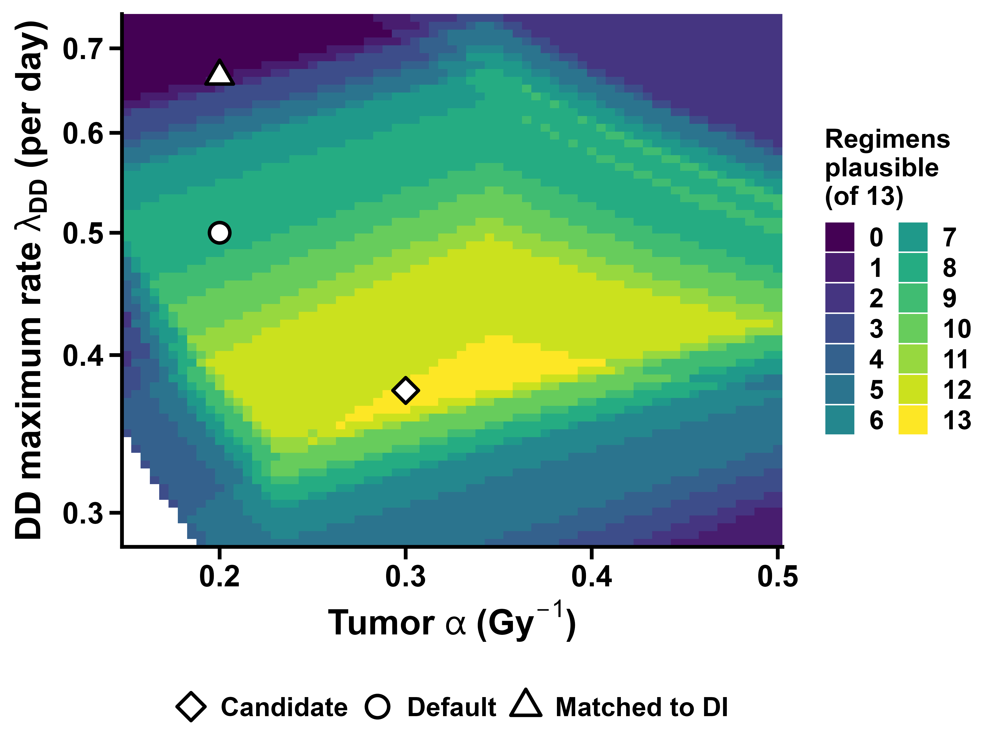

Igor Shuryak, MD, PhD

is144@cumc.columbia.edu

October 18, 2026

# Summary

- **Question.** In the head and neck squamous cell carcinoma (HNSCC) biologically effective dose (BED) calculator, can the tumor radiosensitivity α and the maximum repopulation rate λ~DD~ of the dose-dependent (DD) repopulation model be chosen so that the repopulation onset, the repopulation doubling time and the daily BED loss are clinically plausible for all 13 regimens examined earlier (standard 70 Gy in 35 fractions, UK 65 Gy in 30 fractions, both HYPNO arms, HYHOPE and eight randomized-trial arms)?
- **Calibration kept as now.** The dose-independent (DI) model keeps λ~DI~ = 0.2 per day and T~k~ = 28 days, and the DD model is calibrated so that it equals the DI model for 70 Gy in 35 fractions over 47 days.
- **All three quantities together: no.** No combination makes onset, doubling time and daily loss plausible for all 13 regimens. The best combinations reach 10 of 13 regimens with loose plausibility limits and 8 of 13 with strict limits. The current default (α 0.2, λ~DD~ 0.5) reaches 7 of 13.
- **Why.** The DD onset of any regimen is a fixed fraction of the reference onset, set only by the schedule. Neither α nor λ~DD~ changes these fractions. Short intensive courses therefore always start repopulating much earlier than the standard course.
- **Rate and daily loss first, onset second: yes, in a narrow band.** With loose limits, doubling time and daily loss are plausible for all 13 regimens when α is 0.265–0.405 Gy^−1^ and λ~DD~ is 0.35–0.41 per day. A central choice is **α = 0.30 Gy^−1^, λ~DD~ = 0.375 per day**: DD doubling times 2.3–4.5 days, DD daily losses 0.52–0.99 Gy~10~, and a DI daily loss of 0.67 Gy~10~, matching Fowler's 0.66. Onset is then plausible for 7 of 13 regimens (up to 9 of 13 at α = 0.40, where the DI daily loss falls to 0.50 Gy~10~).
- **What does not change.** At every plausible point the DD model still predicts a BED loss for the GORTEC and TROG accelerated arms, which improved tumor control, and a deficit of about 6 Gy~10~ for HYPNO, which showed no difference. The suggested hypofractionated list also shrinks: with α = 0.30, no regimen passes the strict early-toxicity limit, and 12 pass the Fowler limit of 59 Gy~10~, none credited by the DD model.

# Methods

**Models.** BED = $nd\,(1 + d/(\alpha/\beta))$ with α/β = 10 Gy. DI: repopulation from day T~k~ at rate λ~DI~. DD (Shuryak, Hall and Brenner 2018 [1]): repopulation from day $C\,T/(\alpha K)$ at rate $\lambda_{DD}P_{kill}$, with $P_{kill} = 1 - e^{-\alpha K/T}$. For each regimen, doubling time = ln 2 / rate, and daily BED loss = rate / α (Gy~10~ per day after onset).

**Calibration.** For each (α, λ~DD~), C is solved so that BED~DD~ = BED~DI~ for 70 Gy in 35 fractions over 47 days, with λ~DI~ = 0.2 per day and T~k~ = 28 days, exactly as in the calculator. Because λ~DI~ is held fixed, changing α also changes the DI daily loss, 0.2/α.

**Grid.** α from 0.05 to 0.80 Gy^−1^ (steps of 0.01, refined to 0.005 for the rate-first search) and λ~DD~ from 0.1 to 30 per day (300 to 400 log-spaced values). About 22,800 combinations per search, of which about 20,400 can be calibrated (the rest have λ~DD~ too small to reproduce the DI loss).

**Regimens.** The 13 regimens of the companion note (`DI_DD_clinical_regimens_2026_10_18.docx`). Trial arms use the average schedules tabulated in Shuryak et al. 2018, Table 1 [1].

**Plausibility limits.** A regimen is judged only on quantities that apply to it: if its DD onset falls after its last treatment day, it has no repopulation and its rate and loss are not judged. The limits are my choices, informed by the sources below.

| Quantity | Loose limits | Strict limits | Basis |
|---|---|---|---|
| Repopulation onset | 18–35 days | 21–35 days | Human estimates 18–32 days and T~k~ 21–32 days (Fowler 2010 [2]), 4 ± 1 weeks (Withers 1988 [3]) |
| Doubling time during repopulation | 2–6 days | 3–5 days | About 4 days (Withers [3]), 3 days (Fowler [2]), 1.8–2.3 days in Fowler's analysis of the RTOG 90-03 arms [2] |
| Daily BED loss | 0.5–1.0 Gy~10~ | 0.6–0.8 Gy~10~ | 0.72 Gy~10~ (Withers [3]), 0.66 Gy~10~ and "no more than about 0.7 Gy/day" (Fowler [2]), 0.65 Gy per day (HYPNO design [4]) |

# Result 1: all three quantities together

| Limits | Best number of plausible regimens (of 13) | Where | Regimens that fail at the best points |
|---|---|---|---|
| Loose | 10 | α 0.31–0.53, λ~DD~ 0.41–0.54 per day (145 combinations) | HYHOPE, GORTEC, CHART |
| Strict | 8 | α 0.29–0.32, λ~DD~ 0.44–0.48 per day (9 combinations) | HYPNO test, HYHOPE, GORTEC, TROG, CHART (or the same without HYPNO) |
| Current default, α 0.2, λ~DD~ 0.5 | 7 (loose), 3 (strict) | | HYPNO test, HYHOPE, CAIR, GORTEC, TROG, CHART |
| Matched to DI, α 0.2, λ~DD~ 0.666 | 1 (loose), 0 (strict) | | All but the reference: daily losses of 1.0 Gy~10~ or more |

{width=7in}

**Why no combination works.** The DD onset of a regimen is onset~ref~ × (T/K) / (T/K)~ref~. This ratio depends only on the schedule: HYPNO test 0.66, TROG 0.61, HYHOPE 0.56, GORTEC 0.52, CHART 0.35, and 0.86–0.98 for the 5–7-week schedules. α and λ~DD~ move only the reference onset. Keeping short courses from repopulating before about day 18, or before they end, needs a reference onset of about 35 days, the top of the clinical range. The calibration then has to fit the DI loss of the standard course (19 days of DI repopulation) into about 12 days, so DD repopulation must be about 1.6 times faster than DI's. Regimens with more daily cell killing repopulate faster still. α only trades doubling time against daily loss (loss = rate/α), so it cannot rescue both.

# Result 2: doubling time and daily loss first, onset second

Following the decision to give the repopulation rate and the daily BED loss precedence over onset, the grid was searched for combinations where all 13 regimens have a plausible doubling time and daily loss. Among those, the combinations with the most plausible onsets were preferred.

- **Loose limits:** possible. 109–110 combinations, all in a narrow band: α 0.265–0.405 Gy^−1^, λ~DD~ 0.352–0.412 per day. Onset is then plausible for at most 9 of 13 regimens.
- **Strict limits:** only degenerate solutions, with λ~DD~ of 22–30 per day and a reference onset of 46.7–47.1 days, so that repopulation starts on the last day of the standard course. These are not meaningful and are not considered further.

| α (Gy^−1^) | DI daily loss (Gy~10~) | λ~DD~ range (per day) | DD reference onset (day) | Most regimens with plausible onset |
|---|---|---|---|---|
| 0.265 | 0.75 | 0.352 | 18.4 | 1 |
| 0.285 | 0.70 | 0.362–0.367 | 20.7–21.1 | 7 |
| 0.305 | 0.66 | 0.367–0.383 | 22.4–23.4 | 8 |
| 0.325 | 0.62 | 0.373–0.394 | 23.8–25.1 | 8 |
| 0.345 | 0.58 | 0.378–0.412 | 25.2–26.9 | 8 |
| 0.365 | 0.55 | 0.383–0.406 | 26.3–27.5 | 9 |
| 0.385 | 0.52 | 0.389–0.400 | 27.4–27.9 | 9 |
| 0.405 | 0.49 | 0.394 | 28.3 | 9 |

Along the band, larger α moves every onset later (more plausible) but lowers the DI daily loss from 0.75 to 0.49 Gy~10~. The published DI losses (0.65–0.77 Gy~10~) correspond to α of about 0.27–0.31 Gy^−1^, which also matches the α of 0.3 Gy^−1^ used by Hartley et al. [5] and is close to Fowler's 0.35 Gy^−1^ [2].

{width=7in}

# Two candidate settings, regimen by regimen

Candidate 1, α = 0.30 Gy^−1^ and λ~DD~ = 0.375 per day, sits in the middle of the band where the DI daily loss matches the literature (0.67 Gy~10~). Its DD reference onset is day 22.6. Candidate 2, α = 0.40 Gy^−1^ and λ~DD~ = 0.394 per day, gives the most plausible onsets but a DI daily loss of only 0.50 Gy~10~. Its DD reference onset is day 28.1. In both, every regimen has a doubling time of 2.0–4.5 days and a daily loss of 0.50–0.99 Gy~10~. An asterisk marks an onset before day 18.

| Regimen | T (d) | C1 onset (day) | C1 doubling (d) | C1 loss (Gy~10~/d) | C1 BED~DI~ / BED~DD~ | C2 onset (day) | C2 doubling (d) | C2 loss (Gy~10~/d) | C2 BED~DI~ / BED~DD~ |
|---|---|---|---|---|---|---|---|---|---|
| A. Standard, 70 Gy/35 fractions | 47 | 22.6 | 4.5 | 0.52 | 71.3 / 71.3 | 28.1 | 3.4 | 0.50 | 74.5 / 74.5 |
| B. UK, 65 Gy/30 fractions | 40 | 20.4 | 4.1 | 0.56 | 71.1 / 68.1 | 25.4 | 3.2 | 0.54 | 73.1 / 71.2 |
| C. HYPNO control, 66 Gy/33 fractions | 38 | 19.4 | 4.0 | 0.58 | 72.5 / 68.4 | 24.1 | 3.1 | 0.56 | 74.2 / 71.5 |
| D. HYPNO test, 55 Gy/20 fractions | 26 | 15.0* | 3.3 | 0.69 | 70.1 / 62.5 | 18.6 | 2.7 | 0.65 | 70.1 / 65.3 |
| E. HYHOPE, 46.5 Gy/15 fractions | 19 | 12.6* | 3.0 | 0.77 | 60.9 / 56.0 | 15.7* | 2.4 | 0.71 | 60.9 / 58.5 |
| F. DAHANCA 6&7 | 39 | 19.6 | 4.0 | 0.58 | 73.1 / 69.2 | 24.4 | 3.1 | 0.55 | 74.9 / 72.3 |
| G. CAIR | 40 | 17.9* | 3.8 | 0.62 | 82.4 / 76.8 | 22.2 | 3.0 | 0.59 | 84.4 / 80.0 |
| H. GORTEC very accelerated | 22 | 11.7* | 2.9 | 0.80 | 75.6 / 67.4 | 14.6* | 2.4 | 0.74 | 75.6 / 70.2 |
| I. TROG accelerated | 24 | 13.8* | 3.2 | 0.73 | 70.1 / 62.7 | 17.2* | 2.6 | 0.68 | 70.1 / 65.5 |
| J. CHART | 12 | 7.8* | 2.3 | 0.99 | 62.1 / 58.0 | 9.7* | 2.0 | 0.86 | 62.1 / 60.1 |
| K. RTOG 9003 concomitant boost | 43 | 20.8 | 4.2 | 0.55 | 73.5 / 71.3 | 25.9 | 3.3 | 0.53 | 76.0 / 74.4 |
| L. RTOG 9003 hyperfractionation | 50 | 22.1 | 4.4 | 0.53 | 76.7 / 76.7 | 27.5 | 3.4 | 0.51 | 80.4 / 79.9 |
| M. EORTC 22791 hyperfractionation | 51 | 21.9 | 4.3 | 0.53 | 78.7 / 78.6 | 27.2 | 3.4 | 0.51 | 82.6 / 81.9 |

# Comparison with the trial results

Differences from each trial's own control arm (Gy~10~), next to the observed difference in tumor control as tabulated in Shuryak et al. 2018, Table 1 [1] (HYPNO: within 1.4 percentage points at 3 years [4]).

| Trial arm | Observed Δ tumor control (points) | Default (α 0.2, λ~DD~ 0.5): ΔDI / ΔDD | C1 (α 0.30, λ~DD~ 0.375): ΔDI / ΔDD | C2 (α 0.40, λ~DD~ 0.394): ΔDI / ΔDD |
|---|---|---|---|---|
| D. HYPNO test | within ±1.4 | +0.9 / −4.7 | −2.4 / −5.9 | −4.1 / −6.1 |
| F. DAHANCA 6&7 | +7.0 | +7.0 / +0.5 | +4.7 / +0.5 | +3.5 / +0.5 |
| G. CAIR | +45.7 | +14.0 / +1.2 | +9.3 / +1.1 | +7.0 / +1.1 |
| H. GORTEC very accelerated | +18.2 | +11.6 / −2.6 | +4.9 / −3.9 | +1.6 / −4.3 |
| I. TROG accelerated | +8.5 | +8.1 / −6.6 | +0.8 / −8.5 | −2.9 / −8.8 |
| J. CHART | −1.2 | −0.1 / −7.3 | −5.8 / −9.9 | −8.6 / −10.9 |
| K. RTOG 9003 concomitant boost | +9.7 | +6.5 / +0.2 | +4.2 / +0.1 | +3.0 / +0.1 |
| L. RTOG 9003 hyperfractionation | +10.0 | +7.4 / +4.6 | +7.4 / +5.5 | +7.4 / +5.6 |
| M. EORTC 22791 hyperfractionation | +1.0 | +10.1 / +6.2 | +10.1 / +7.5 | +10.1 / +7.6 |

- Making the DD rates plausible does not fix the direction of the DD predictions. At both candidates the DD model still predicts a loss for GORTEC and TROG, which improved tumor control, and a deficit of about 6 Gy~10~ for HYPNO.
- Raising α also weakens the DI model's agreement with the accelerated arms, because it lowers the DI daily loss: at C2 the DI model predicts losses for TROG and HYPNO. At C1 the DI direction is still right for 8 of 9 comparisons, but by smaller margins.
- This is a check of direction with unfitted parameters, not a fit. The 2018 analysis [1], which fitted α, the rates, the onset parameter and stage-specific clonogen numbers, found the DD model better overall.

# Implications for the calculator

- **A defensible DD setting exists if rate and daily loss take precedence.** α ≈ 0.30 Gy^−1^ with λ~DD~ ≈ 0.375 per day keeps the current calibration and gives clinically plausible DD doubling times and daily losses for all 13 regimens, with the DI daily loss at Fowler's value. Its cost is early DD onsets (days 8–15) for courses shorter than about 4 weeks, which is the DD model's central hypothesis and is not established clinically.
- **Rounded values.** α = 0.30 Gy^−1^ with λ~DD~ = 0.40 per day (reference onset day 24.1) gives doubling times of 2.2–4.2 days and daily losses of 0.55–1.05 Gy~10~: only CHART slightly exceeds the 1.0 Gy~10~ limit. λ~DD~ = 0.38 per day keeps all 13 regimens within the limits (0.53–1.00 Gy~10~). Either is a reasonable default candidate if rate and daily loss take precedence over onset.
- **It changes the suggestions.** With α = 0.30 the DI daily loss drops from 1.00 to 0.67 Gy~10~. Under the strict early-toxicity limit (no higher than the standard course) the search then returns no regimen, as with the published parameter sets. Under the Fowler limit of 59 Gy~10~ it returns 12, all credited by the DI model only. At α = 0.40 the Fowler limit leaves 5.
- **The band is narrow and depends on the limits.** At the candidate, the DD daily loss ranges from 0.52 Gy~10~ (standard course) to 0.99 Gy~10~ (CHART), almost a factor of 2, which only just fits the loose 0.5–1.0 window. A narrower window empties the band. Any default chosen this way should be presented with these limits stated.
- **The direction mismatch is structural.** No parameter choice tested here makes the DD model reproduce the gains of the accelerated trial arms. That needs a change to the model itself (for example a weaker dependence of onset on cumulative cell killing) or a fit to the trial data, not a different default.

# Limitations

- The plausibility limits are judgments informed by published estimates that come mainly from 5–7-week schedules.
- Schedules with two or three fractions per day are evaluated without incomplete repair between same-day fractions.
- Trial-arm schedules are averages from a published compilation, and tumor control was measured at different times and stages across trials.
- λ~DI~ and T~k~ were held at the calculator defaults, as requested. A search that also varied them would explore a larger space.
- Concurrent chemotherapy is not part of any BED here.

# Files

All grid results are in the folder `dd_grid_2026_10_18/`: `grid_variantA.csv` (all three quantities), `grid_rate_first.csv` (rate and loss first, both limit sets), `feasible_region_by_alpha.csv`, `candidate_points_regimens.csv`, and the figures.

# References

1. Shuryak I, Hall EJ, Brenner DJ. Dose dependence of accelerated repopulation in head and neck cancer: supporting evidence and clinical implications. Radiother Oncol. 2018;127(1):20-26. https://doi.org/10.1016/j.radonc.2018.02.015 (PMID 29534828)
2. Fowler JF. 21 years of biologically effective dose. Br J Radiol. 2010;83(991):554-568. https://doi.org/10.1259/bjr/31372149 (PMID 20603408)
3. Withers HR, Taylor JMG, Maciejewski B. The hazard of accelerated tumor clonogen repopulation during radiotherapy. Acta Oncol. 1988;27(2):131-146. https://doi.org/10.3109/02841868809090333 (PMID 3390344)
4. Bentzen SM, Gupta T, Jacinto AA, et al. Hypofractionated versus normofractionated accelerated radiation therapy with or without cisplatin for locally advanced head and neck squamous cell carcinoma (HYPNO): a randomized, open-label, phase 3, noninferiority trial. Int J Radiat Oncol Biol Phys. 2026;125(2):387-398. https://doi.org/10.1016/j.ijrobp.2025.12.056 (PMID 41711624)
5. Hartley A, Sanghera P, Kazi W, et al. Correlation of currently used radiobiological parameters with local control and acute and late mucosal toxicity in randomised studies of altered fractionation for locally advanced head and neck cancer. Clin Oncol (R Coll Radiol). 2011;23(1):29-33. https://doi.org/10.1016/j.clon.2010.08.007 (PMID 20829006)
