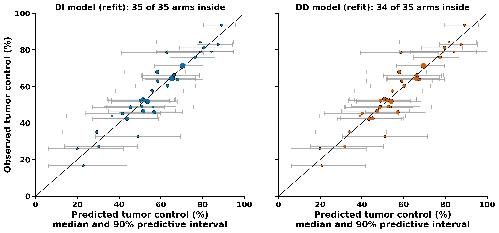

# Summary

This report is the Phase 2 checkpoint of `PLAN_v3_2026_10_20.md`. It describes the Bayesian refit of the dose-independent (DI) and dose-dependent (DD) repopulation models and asks for decisions 2 and 3 to be confirmed before the refit becomes a default anywhere in the calculator. Nothing in version 3 uses the refit as a default. It is offered as a labeled preset, as a "fitted DD" option, and on the Uncertainty tab.

Main findings:

1. **The data were transcribed twice, independently, with no disagreement** (35 arms × 12 columns, 7283 patients, as the paper states).
2. **Overdispersion is real.** With one intercept per trial, the Pearson χ² per degree of freedom is 3.65 (DI) and 3.41 (DD). The arm-level standard deviation on the log(−log TCP) scale is about 0.20 (95% interval 0.11–0.36) in every overdispersed fit.
3. **The DI model is informed by the randomized contrasts.** The daily repopulation loss λ/α has median 0.48 Gy₁₀/day (95% interval 0.10–1.60), against a prior 95% interval of 0.015–17. Background growth adds g/α = 0.40 Gy₁₀/day (0.14–0.97) over the whole course. The onset day is only weakly informed (median 31.8, 95% interval 13.0–45.4).
4. **The DD model's repopulation parameters are not identified by these data.** Its rate and onset constant reproduce their priors. Leave-one-trial-out cross-validation gives the same predictive accuracy for both models (DD minus DI: −0.06 ± 1.86 log units).
5. **The published preference for DD (AICc difference about 40) does not survive per-trial intercepts.** Without stage-based clonogen terms the maximum-likelihood fits differ by 1.96 log-likelihood units with the same number of parameters.
6. **Tumor α/β is not informed** (posterior equals prior in every variant), and the trials cover only 1.1–2.5 Gy per fraction.

# 1. Data

Source: Shuryak, Hall and Brenner, Radiother Oncol 2018;127:20–26, Table 1 (35 arms from 16 publications).

- Two transcriptions were made independently, one by hand from the page and one by a separate reader working from a 330-dpi rendering. They agree on every cell (`double_entry/entry_A_table1.csv`, `entry_B_table1.csv`). The patient column sums to 7283 and there are 16 distinct references, as stated in the paper.
- The signs of the log-likelihood column were taken from the page image, because the text layer drops them.
- Table 2's onset-parameter row is labeled with the DI and DD meanings swapped: the DI column holds *T*ₖ (28.6 days) and the DD column holds *C* (14.5). The calculator's text was not affected.
- Support of the data: dose per fraction 1.1–2.5 Gy, 27–70 fractions, overall time 12–66.5 days. Every hypofractionated candidate above 2.5 Gy per fraction is an extrapolation, and the app flags it.
- Stage mix is not tabulated, so the stage-specific clonogen numbers of the paper cannot be refitted. Each trial gets its own intercept instead, so only within-trial contrasts inform the radiobiological parameters.
- The number controlled in an arm is the reported tumor control times the number of patients, rounded. Tumor control is actuarial in most trials, so this count is an approximation.

# 2. Model

For arm *i* of trial *j*, with BED_LQ = *n d* (1 + *d*/(α/β)):

- DI: log(−log TCP) = *c*ⱼ − α (BED_LQ − mean_j) + λ s(*T* − *T*ₖ) + *g* (*T* − mean_j) + σ *z*ᵢ
- DD: log(−log TCP) = *c*ⱼ − α (BED_LQ − mean_j) + λ P_kill s(*T* − (*C*/α) *T* / BED_LQ) + *g* (*T* − mean_j) + σ *z*ᵢ, with P_kill = 1 − exp(−α BED_LQ / *T*)

Here s(·) is the calculator's smooth hinge (k = 3 per day), *z*ᵢ ~ N(0, 1) is the arm-level overdispersion term, and the likelihood is binomial. Centering BED and time within each trial removes the correlation between each intercept and α. Without it the sampler struggled (first attempt: 25 divergent transitions, R-hat 1.028 for DD).

Priors (stated assumptions):

| Parameter | Prior |
|---|---|
| α/β | lognormal, median 10 Gy, 95% 5–20 Gy (the range the 2018 paper calls plausible) |
| α | lognormal, median 0.2 per Gy, log-sd 1 |
| λ (DI) | lognormal, median 0.1 per day, log-sd 1.5 |
| λ (DD) | lognormal, median 0.5 per day, log-sd 1.5 |
| *T*ₖ | normal, mean 28 days, sd 10, truncated to 0–60 |
| *C* | lognormal, median 10, log-sd 1 |
| *g* | uniform 0.0046–0.021 per day (the paper's plausible range) |
| *c*ⱼ | normal(0, 3) on the centered scale |
| σ | half-normal(0, 0.5) |

Sampling: CmdStan 2.40, 4 chains, 1500 warm-up and 2000 sampling iterations each, adapt_delta 0.99, maximum tree depth 12, seed 20261021. Scripts: `fit/fit_refit.py`, `fit/stan/`. Raw chains stay outside the repository, and summaries are in `fit/output/`.

Variants: **primary** (as above), **binomial** (no overdispersion term), **paper restrictions** (α/β fixed at 10 Gy and *g* at 0.0154 per day, as in 2018) and **wide α/β** (log-sd doubled to 0.707).

# 3. Diagnostics

| Fit | Divergent transitions (of 8000) | Largest R-hat | Smallest bulk ESS | Arms inside 90% predictive interval |
|---|---|---|---|---|
| DI primary | 0 | 1.002 | 2076 | 35 of 35 |
| DI binomial | 0 | 1.001 | 1875 | 31 of 35 |
| DI paper restrictions | 0 | 1.001 | 2315 | 35 of 35 |
| DI wide α/β | 0 | 1.001 | 2226 | 35 of 35 |
| DD primary | 28 | 1.003 | 1749 | 34 of 35 |
| DD binomial | 79 | 1.032 | 94 | 31 of 35 |
| DD paper restrictions | 21 | 1.004 | 879 | 34 of 35 |
| DD wide α/β | 54 | 1.004 | 1186 | 35 of 35 |

The DI fits are clean. The DD fits have a small number of divergent transitions (0.3–1%), concentrated at small *C* and larger σ, which is the region where the poorly identified DD parameters trade off. The DD binomial fit does not mix (bulk ESS 94) and is reported only as a sensitivity check. The binomial fits leave 4 of 35 arms outside their predictive intervals, which agrees with the overdispersion seen in the maximum-likelihood check.

The one arm outside the DD interval is Skladowski 2006, 7 days per week (51 patients): observed 78%, predicted 59% (90% interval 39–76%).

# 4. Posterior estimates (primary fits)

Medians with 95% intervals. Quantities marked as identified are the ones the BED differences depend on.

| Quantity | DI refit | DD refit | 2018 published fit |
|---|---|---|---|
| α (per Gy) | 0.032 (0.013–0.058) | 0.027 (0.011–0.050) | DI 0.069, DD 0.224 |
| λ (per day) | 0.015 (0.003–0.037) | 0.47 (0.03–8.7), equals its prior | DI 0.035, DD 1.17 |
| λ/α, Gy₁₀ per day (identified) | 0.48 (0.10–1.60) | 17 (1.0–390) | DI 0.51, DD 5.2 |
| *g*/α, Gy₁₀ per day (identified) | 0.40 (0.14–0.97) | 0.63 (0.30–1.50) | DI 0.22, DD 0.069 |
| *T*ₖ (days) | 31.8 (13.0–45.4) | not applicable | 28.6 |
| *C* | not applicable | 10.2 (1.9–72), equals its prior | 14.5 |
| *C*/α (Gy) | not applicable | 392 (61–3345) | 65 |
| α/β (Gy) | 10.1 (5.3–19.9), equals its prior | 10.4 (5.5–20.6), equals its prior | fixed at 10 |
| σ (arm-level) | 0.20 (0.11–0.36) | 0.20 (0.11–0.36) | none |

The published values in the last column are from Table 2 of the 2018 paper, and the ratios are computed from them.

Interpretation:

- **α is small because it is population-level.** With one intercept per trial and arms that pool many patients, the dose-response slope includes patient-to-patient variation. This is why the refit α (about 0.03 per Gy) is below cell-line values and below the paper's DD α. It does not change the meaning of BED in Gy₁₀, but it makes any tumor-control prediction shallow.
- **The DI time cost is close to the literature.** Repopulation after day 32 costs 0.48 Gy₁₀ per day and background growth 0.40 Gy₁₀ per day throughout, so the total late-course cost is about 0.9 Gy₁₀ per day. Published values are 0.6–0.84 Gy₁₀ per day (Withers 1988, Fowler 2010, and 0.78 in HYPNO's design).
- **DD's onset constant puts onset after the end of treatment in most draws.** With *C*/α near 392 Gy and BED_LQ near 84 Gy for 35 × 2 Gy, the onset day is about 4.7 *T*, so DD acts mainly through background growth. The data do not distinguish this from a DD model with active repopulation.

Prior sensitivity (λ/α for DI, median and 95% interval): primary 0.48 (0.10–1.60), paper restrictions 0.38 (0.09–1.21), wide α/β 0.49 (0.10–1.59) and binomial 0.47 (0.11–1.02). The conclusions do not depend on the α/β prior or on fixing *g*.

# 5. Model comparison

**Leave one trial out.** Each trial was removed in turn, both models were refitted to the other 15, and the removed trial's remaining arms were predicted from its first-listed arm, which fixes that trial's intercept. Expected log predictive density summed over the 16 trials: DI −80.90 and DD −80.95, a difference (DD − DI) of −0.06 with standard error 1.86. The largest single-trial differences are Hansen 1997 (+1.18 for DD) and Skladowski 2006 (−1.17). Approximation: the reference arm's own sampling noise is ignored when it fixes the intercept. The cross-validation refits used 4 × 500 samples and had 6 (DI) and 271 (DD) divergent transitions in total over 16 refits each.

**Maximum likelihood without overdispersion** (α/β 10 Gy, *g* 0.0154, per-trial intercepts, `fit/output/mle_check.json`): negative log-likelihood DI 4713.10, DD 4711.14, a difference of 1.96 with the same number of parameters. The paper's difference (AICc about 40) came from the model with stage-based clonogen numbers, which these data cannot reproduce without the stage mix.

Conclusion: the randomized within-trial contrasts in these 35 arms do not discriminate between DI and DD.

# 6. What the refit implies for the regimens of interest

Tumor BED difference from 35 × 2 Gy in 47 days (Gy₁₀), median (80% range), under the primary refit draws (4000 draws, `fit/output/report_quantities.json`, computed with the app's engine):

| Regimen | DI refit | DD refit | Share of DI draws with Δ ≥ 0 | D18 preset (DI / DD calibrated) |
|---|---|---|---|---|
| HYPNO 55 Gy/20 (26 d) | +1.2 (−3.6 to +9.5) | −0.5 (−5.3 to +7.5) | 60% | −1.4 / −8.7 |
| 17 × 3.05 Gy (23 d) | +0.3 (−5.2 to +9.3) | −1.0 (−6.5 to +8.2) | 50% | −3.9 / −10.3 |
| 18 × 2.90 Gy (24 d) | −0.6 (−5.7 to +8.2) | −2.0 (−7.2 to +6.8) | 45% | −4.2 / −10.6 |
| 19 × 2.80 Gy (25 d) | −0.3 (−5.3 to +8.2) | −1.9 (−6.9 to +6.5) | 45% | −3.4 / −10.1 |
| HYHOPE 46.5 Gy/15 (19 d) | −4.7 (−10.6 to +5.2) | −5.3 (−11.5 to +5.3) | 25% | −10.6 / −15.1 |
| 30 × 2 Gy (40 d) | −6.0 (−8.2 to −2.1) | −7.5 (−9.2 to −4.5) | 5% | −7.4 / −8.4 |
| HYPNO control 66 Gy/33, 6/week (38 d) | +2.8 (+0.2 to +7.5) | +0.9 (−1.1 to +4.3) | 90% | +1.1 / −2.9 |

Shares are rounded to 5 points. In 23 of 4000 DI draws (44 of 4000 DD draws) the comparison's own BED is not positive. Those draws count as not meeting any criterion.

Points worth noting:

- The intervals are wide for every hypofractionated schedule, because the onset day and the daily loss are only partly determined by these trials. The data cannot say whether HYPNO's 55 Gy in 20 fractions gains or loses tumor BED relative to 70 Gy in 35 fractions.
- Both refits say that dropping the last week of 35 × 2 Gy (to 30 × 2 Gy) loses tumor BED (DI: 95% of draws below zero). The 2018 paper's conclusion that the last week can be removed without loss depended on the published DD fit, which these within-trial contrasts do not support.
- The D18 defaults sit at the pessimistic end of the DI refit for the hypofractionated schedules, and its calibrated DD is more pessimistic still.

# 7. Recommendations (decisions for review)

- **Decision 2 (default tumor parameters).** The DI refit is ready to be offered as the default DI parameter set, but I recommend you choose explicitly: it changes every hypofractionated DI difference by about +3 to +6 Gy₁₀ relative to D18, and its α is population-level. Version 3 keeps D18 as the default and offers the refit as the preset "Bayesian refit 2026-10-21".
- **Decision 3 (which DD model).** The plan recommended the refitted DD model as version 3's DD model. The refit does not support that, because its parameters are not identified. I recommend keeping the calibrated DD (version 2) as the DD model, and offering the fitted DD only as a labeled option, which is what version 3 does. Reconsider if stage-level or individual data become available.
- **Before any manuscript use**, the refit should be repeated with the stage mix of each arm (from the 16 source publications) so that the paper's original model can be compared directly.

# 8. Files

- Data: `data/shuryak2018_table1.csv`, `data/shuryak2018_table2_published_fit.csv`, double entry in `double_entry/`.
- Fitting: `fit/fit_refit.py`, `fit/stan/di.stan`, `fit/stan/dd.stan`, `fit/mle_check.py`, `fit/report_quantities.R`, `fit/make_fit_figures.py`.
- Outputs: `fit/output/*/summary.json`, `fit/output/loto_*.json`, `fit/output/provenance.json`, `fit/output/run.log`.
- Draws used by the app: `draws/tumor_{di,dd}_{primary,paper_restrictions}.csv` with `draws/manifest.json` (SHA-256), and `draws/refit_point_values.json`.
